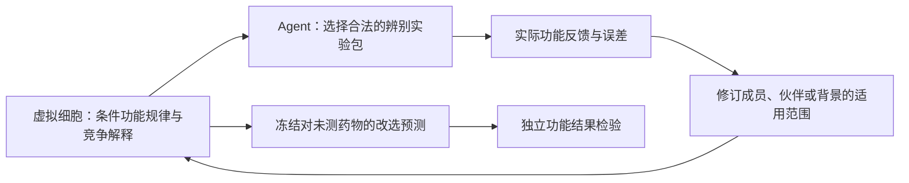

# 药物发现虚拟细胞智能体：核心机制设计

建议围绕一个中心问题设计系统：**少量功能实验能否修订一条药理关系的适用条件，并把这次修订用于尚未测试的药物和组合？** 具体研究对象选为“药物在给定细胞、剂量与组合伙伴下的功能可替换关系”。虚拟细胞表达这条关系及竞争解释，Agent购买区分解释的实验，反馈改变关系的作用范围，再重算未测候选。

这是一个可实施的研究设计，**尚不是已经成立的算法创新**。一般条件建模、反例细化和决策主动学习都有先例；目前最值得争取的是发现并验证有用的、可迁移的条件功能结构。若最终仅得到普通重训练可以等效完成的更新，就保留科学结构发现，不把它命名成独有的共同学习算子。

本报告以2026-10-27 18:23:40（北京时间）的项目快照为界；文献定点核查随后完成。没有新增效果实验或训练。最终候选由冻结的 [v2](candidate_v2.md) 与优先更正 [v3](candidate_v3.md) 定义；原 [v1](candidate_v1.md)、[独立初判](initial_challenge.md)、[原文补查](challenge_source_check.md) 和 [v2复审](challenge_v2.md) 均保留。本报告中的模型、例子和验证均为设计或推理。

## 1. 现有结果如何约束这次设计

| 已有证据 | 当前能说什么 | 对核心设计的影响 |
|---|---|---|
| R196：固定划分的注释排序增益0.144657；cell CI [0.121304,0.166746]，角色分开的drug CI [0.013900,0.223292] | **“replicated_under_audit”已被正式撤回**；药物MDE=0.152731，推断口径与目标不匹配。identity在每折双未见药物上为常数；模型没有细胞特征/药物交互 | 仅保留药物侧粗先验线索；不能据此承诺背景机制或Agent收益。主要基线必须能对未见药物作非恒定预测 |
| R192：外部ρ=0.094640，pair×cell CI [-0.007016,0.179018]，预注册复合规则未过 | 未复现；不等于已否证。端点、构成、功效和真实失效未分离 | 必须在相容端点和条件上确认；不以一次阴性关闭整个方向 |
| R193主Q未算；R194的1.43%是加性条件主效应份额 | 不能把小主效应理解成不存在可复用交互；共享秩1结构可以有零边际均值 | 核心对象应允许“成员×伙伴×背景”的条件变化，避免只看全局均值 |
| R197原协议已作废；截止快照只有协议、修订与脚本，未见v2结果 | 主低秩问题与可辨识模型错位，单药特征还可能机械重构synergy端点 | 既不借其证明结构成立，也不认定结构失败；冷行预测必须有合法侧信息或付费支持 |
| 旧固定线性状态编辑等价标量残差回归；单反馈零空间编辑可归约投影核回归 | 这些指定算子的独特性主张已失败 | 核心不放在“把标量反馈写进隐状态” |
| 旧功能替代细化改善interaction误差，却未改善决策；该条目前可读的是历史二级汇总 | 科学关系、预测改善与决策价值是不同命题 | 新方案必须先列出会改变的未购选择，再由独立功能结果验证 |
| 尚无经认证的cell×drug×匹配暴露×target engagement/遗传参照×独立功能完整配对资源 | 不能判定失效来自参与不足、补偿或脱靶 | 当前层级是操作性功能规律。生物机制解释另需可区分参照 |

R196/R197原记录仍保留。当前来源和hash见 [source_snapshot.json](source_snapshot.json)，细节见 [evidence_audit.md](evidence_audit.md)。同一组药物多次随机划分不增加独立生物样本；折间t区间也不能当独立实验CI。

## 2. 核心研究对象：学习“什么情况下可以复用”

面向预算有限的组合药物筛选团队：已有一个药物系列和候选伙伴，希望进入新肿瘤细胞背景时，判断哪些关系可沿用、哪些必须重测，以及最终优先验证哪个未测组合。当前替代做法是按通路/靶点分组、重训响应模型，或用随机/主动筛选；本线必须在相同资源下证明额外价值。实验节省和药物发现效益均是待验证应用。

固定细胞c、药物a、替代药a′、伙伴b、合法剂量/暴露和功能终点，定义：

\[
\Delta(c;a,a';b)=\mathbb E[y(c,a,b)]-\mathbb E[y(c,a',b)].
\]

它回答“在这项具体组合决策里，换药会损失多少功能效用”。同靶点、相似RNA或相似单药效应都不自动使Δ接近0。剂量需声明为固定方案或事先定义的可比较方案；不能看到结果后寻找最有利剂量来宣布可替换。

一条模型规律至少输出：

`成员范围 × 伙伴范围 × 细胞条件 × dose/time × endpoint → Δ分布、实测支持、反例与证据级别`。

例如“在背景条件k成立、伙伴特征g=1时，某成员族的替换损失变大”，先是一条功能性竞争假说。没有靶点参与或救援实验，就不能把k命名成“代偿激活”，也不能把成员差异叫“脱靶”。

“功能类”只是这些关系的可读压缩。理想类内最大替换损失D≤ε是目标定义，不能由稀疏点预测自动认证。近似相似不具传递性；不能把“不显著不同”的成对边连起来当等价类。若每个药自成一类，形式正确但没有测量收益。

## 3. 只保留三个必要模块

**M1：表达有作用范围的竞争药理规律。** 输入预干预细胞特征、药物结构/注释、合法实验条件、源背景数据及明确购买的目标支持。用现成强预测器作基础，重点学习Δ及其成员、伙伴和背景条件。最小可写为：

\[
\Delta_s(x)=\Delta_{\mathrm{base},\theta}(x)+\sum_{j\in J_s}\gamma_jh_j(x).
\]

h是从开发背景冻结的低复杂度条件，例如可得成员特征v、伙伴特征g和背景特征k的交互；s代表不同的共享范围。至少保留“原关系仍成立”“某一成员失效”“一族成员只对某类伙伴失效”“无可支持共享规律”等竞争解释。不能只挑一个模型，再把其预测区间当全部机制不确定性。

现有虚拟细胞的细胞嵌入或扰动表征可作为输入，但必须与普通细胞特征/单药功能基线对照。没有证据表明深表征是必要成分时，不新增骨干。这里学习的是**条件功能响应模型**；它尚不是恢复真实细胞全过程的完整世界模型。

**M2：Agent购买能区分解释、影响选择的对照包。** 动作是实际可执行的板/培养包，例如同细胞、同暴露下的(a,b)与(a′,b)，加必要vehicle、单药和独立重复；跨背景对比还需源背景参照。需要区分成员条件时，测试另一个成员；需要区分伙伴条件时，测试另一个伙伴；这两类实验不能互换。共享对照和批次依赖进入联合推断。

采样器可先使用已有知识梯度、决策VOI或整板PDBAL：在真实成本下，选择预期能降低最终选择损失的包。**最小**指达到指定决策精度所需的最小可执行成本，不是理论上最少的免费标量。对所有竞争模型都错的情形，还需计费的独立审计动作；模型一致不是事实正确。

**M3：反馈修订规律范围，再导出未测预测。** 新结果不只校正被测点：各竞争假说使用全部合法历史重新拟合，条件项γ改变具有相同条件的未测Δ。若共享证据不足，保留宽区间或退回不共享模型，不强行生成新规律。边界g如果由本任务反馈探索，只能在另一独立成员/伙伴/任务上确认；不能同一反例既定义边界又验证边界。

最小实现是普通受约束模型选择：对每个s拟合联合损失和已声明正则，再用开发集冻结的复杂度准则/分组选择比较s。**这个统计实现是已有工具，不是新算子**。它给出可评估原型：比较“规则真正参与预测”与“普通预测器重训后仅把结果分组”，看是否存在不能由后一种做法解释的收益。两者等效时，算法创新主张必须撤下。

LLM若使用，只负责把假说转成受校验的实验/工具调用及证据记录；LLM投票、自然语言规则、RAG和记忆不是本研究的核心创新。

## 4. 一次反馈怎样改变其他药物：明确的区分例

以下为纸面构造，不是真实药效。设a1、a2具有部署前已知特征v=1；b1、b2属于伙伴族g=1，b3属于g=0；Δ为相对参考药a0的效用差。

| 竞争解释 | a1+b1 | a1+b3 | a2+b1 | a2+b2，留作未购测试 |
|---|---:|---:|---:|---:|
| 原关系保持 | 0 | 0 | 0 | 0 |
| 只有a1普遍失效 | −0.30 | −0.30 | 0 | 0 |
| 所有v=1成员只在g=1伙伴下失效 | −0.30 | 0 | −0.30 | −0.30 |
| 只有a1+b1这一格异常 | −0.30 | 0 | 0 | 0 |

首个−0.30反例无法定位条件。a1+b3区分“普遍失效”与“伙伴条件失效”；a2+b1区分“单格异常”与“跨成员规律”，并获得另一个成员的直接观测。若三个反馈依次为−0.30、0、−0.30，在这四个冻结候选中，第三条留下。

同一表中，a1+b2也能区分“单格异常”和“伙伴条件失效”；选a2+b1的额外价值是获得另一个成员的直接证据，不能说前者没有区分力。这是独立复审后纠正的具体逻辑错误。

若参考a0+b2的同条件效用预测0.65、原Δ预测0、备选组合0.50，则Δ修订为−0.30后，a2+b2变0.35，系统会改选；参考效用的迁移不确定性也必须计入。未购a2+b2的独立功能结果判断是否改对。此例明确b2在源/开发数据已出现，但未购买目标背景的b2反馈；a2已出现于目标支持，所以这仅是目标新组合/伙伴扩展，不能认证严格整新成员或整新伙伴。真正整新成员、伙伴和细胞需另留。

任意更复杂解释H*仍可在三次反馈上完全相同、只在未测组合反向。因此**有限模型内的可辨别不等于真实生物机制已辨识**。起作用的是经检验的共享结构，而非Agent能够从无信息中推出事实。普通同信息层级/规则模型也能得到这个结果，这个例子证明设计可操作，不证明算法独特。

## 5. 真正可能形成贡献的是什么

| 来源/最近工作 | 已经具备的机制 | 本线仍需新增并验证的内容 |
|---|---|---|
| [BATCHIE，2025](https://doi.org/10.1038/s41467-024-55287-7)，Methods Sec12/14/24/26 | 细胞条件响应、贝叶斯反馈、整板主动实验、一般模型距离及top-K决策距离 | 有用的条件替换/分裂结构是否真实存在、能跨成员与背景复验；不能只换采样距离 |
| [PDTSyn，2026](https://doi.org/10.1093/bib/bbag199) | 共享与细胞特异组合表征，特征生成共享基系数 | 由真实反例修订的具体作用条件及独立功能效用；“共享＋特异”不是差异 |
| [DECANT，2026](https://doi.org/10.1093/bioinformatics/btag662) | 转录层面的药物/背景组织、检索；已讨论多原型/背景分层 | 独立功能可替换及改选收益；转录原型不是靶点参与或药效等价 |
| [Compositional Behavioral Semantics，2026](https://arxiv.org/html/2606.25357v2)，§4–5 | 保持操作/行为的抽象、值等价；当前严格结构保持，近似与实用算法待发展 | 不能直接借其定理认证药物；本线只用其“按可执行操作定义可复用性”的原则 |
| [Generalised Transportability，2026](https://arxiv.org/html/2608.15645v1)，§3.1 | 模型级迁移、近似误差与查询界；要求同变量/图/干预及已知变化机制 | 生物数据尚无这些前提；不能把功能预测写成有因果认证的迁移 |
| [Task-Aware Exploration，2026](https://arxiv.org/html/2602.18724v1)，§3 | 任务表示与探索耦合，预测奖励差及探索奖励 | “表示与探索共同训练”已非差异；稀疏药筛噪声也不是可用机制信息 |
| [AlphaEdit，ICLR2025版本](https://arxiv.org/html/2410.02355v4)；[LOGICZSL，CVPR2025](https://openaccess.thecvf.com/content/CVPR2025/papers/Wu_LOGICZSL_Exploring_Logic-induced_Representation_for_Compositional_Zero-shot_Learning_CVPR_2025_paper.pdf) | 固定键保护；语义树/逻辑约束与组合泛化 | 有实测条件的关系才可检验/修订；投影编辑或LLM规则不能代替药理证据 |

CV值得迁移的是“组合关系必须与使用条件相容”，但类别逻辑不是药效蕴含。NLP值得迁移的是明确更新作用范围；线性零空间编辑在本项目已有等价反例。机器人值得迁移的是区分影响任务的可观测差异与参数真值；[SPI-Active](https://arxiv.org/html/2505.14266v1)有真实输入—状态轨迹，[Poke and Strike](https://arxiv.org/html/2509.00178v1)有仿真特权，终点药筛不具同等条件。不能把同时组合写成顺序动作或物理轨迹。

因此本线的中心可证伪命题是：**存在跨化合物成员与细胞背景复用、与实际组合选择有关的低复杂度功能条件；反例能识别其例外范围，且修订价值超出只纠错已测点。** 这是可能的科学/能力贡献。尚未找到不可归约的新算法操作，也没有证明这一完整科学对象首次提出；本次有界检索不足以给首创结论。

## 6. 最小验证：先区分结构，再区分更新和采样

**E0，资源资格。** 先从元数据冻结成员×伙伴×背景的可执行矩形、剂量/暴露/端点、独立培养/批次、重复和暴露历史。确认组合与单药参照匹配；物理孔/文件数不等于生物重复。选有实际活性、非饱和且存在选择余地的子任务，不能靠全无效/全毒形成大类。现有完整确认资源尚未资格化。

Jaaks的ΔEMAX可开发条件功能预测，但不直接等于原始生长抑制、靶点作用或临床效用。若单药Emax参与synergy端点构造，把它作为输入后得到的增益可能是机械重构；必须加单药构造基线/特征消融。最终药效决策尽量用与学习目标有明确关系的独立功能测量；若只有synergy，就限定为synergy排序任务。活性/非饱和资格必须基于事先可得的开发信息或计费先导实验冻结，不按封存结果事后选有利任务。

**E1，固定相同反馈，检验关系与更新。** 先在源背景冻结候选规则，再在目标背景以相同支持包更新所有方法。未购query与支持分离；原始观测先分割，再构造Δ/Q，避免同一raw key的正负复用跨集合泄漏。分别报告新组合、新药物、新伙伴、新细胞、cell×drug联合留出；目标细胞已购买支持时叫少样本，不能叫零样本。

强基线至少包括非恒定的结构/注释×细胞强预测器、完整历史普通重训练、条件共聚类、低秩/层级交互、多输出GP，以及“条件预测→sup距离→分组→重训练”。它们得到相同特征、规则候选、历史反馈及调参预算；冷行列预测要有侧信息或明确支持，不能让无定义的矩阵分解充当弱基线。

先检验未购Δ/替换损失、预先声明条件的复验、真反馈vs打乱反馈、真实条件vs同规模随机条件。规则只作可视化读出与真正进入预测的版本必须对照。如果分组只是普通模型的读出，停止独有共同学习算子的主张。科学结构存在不要求击败所有模型，但要求独立证据证明结构事实及用途。

**E2，固定更新器，检验取证策略。** E1有可用结构后，再比较随机整包、覆盖采样、GP/BO、知识梯度/决策主动学习、BATCHIE/PDBAL与拟议见证包。总预算包含单药、vehicle、失败板、独立培养、重复、轮次等待和计算调参。主要终点是未购候选最终选择的效用/regret；探针直接命中与总命中另报。若初筛影响最终endpoint，加gate-only控制，避免筛掉初筛失败就被解释成学习。

一个实际固定面板不能提供所有自适应策略的反事实结果：有全覆盖合法数据时可做开发回放；否则每个策略必须实付自己的实验。随机重切历史暴露数据不会恢复独立确认。

**E3，独立任务确认。** 冻结规则、更新器、策略和评价后，在独立培养/筛选及真实未见任务上确认。按共享细胞、药物跨角色、条件、原始key、批次保留依赖；区分固定预测bootstrap与完整重拟合变异。多种细胞对/条件对由同一观测生成时，不把边当独立样本。阈值、ε和最小有用收益来自实际成本/损失及误差，不由旧CI或任意相关系数倒推。

若要宣称靶点/通路机制，另需同背景同暴露的target engagement、匹配遗传扰动/救援或耐药对照及独立功能，且这些测量确能区分当前竞争解释。直接药物干预可验证功能效应；名义靶点不是已观测do(target)，遗传扰动也不天然等价药物剂量。

## 7. 能推翻设计的结果与停线条件

| 结果 | 应得结论/动作 |
|---|---|
| 匹配矩形、合法剂量或独立重复不足 | 当前资源不可检验，列出缺失测量；不是科学假说已失败 |
| 留出损失CI很宽，仍容许实用收益 | 未决，不做等效/失败解释 |
| 精度充分，留出条件关系不复验，或有效药物都退化成单例 | 不支持该条件结构/压缩范围；停止此范围的复用主张 |
| 真反馈不优于打乱反馈，或只能改善已购点 | 停止反馈向未购动作迁移主张 |
| 普通同信息重训练/层级模型等效完成全部效果 | 停独有算子主张；有独立结构事实时仍可研究科学规律 |
| 替换误差下降，但扣除取证成本后的决策收益不成立 | 停药物决策创新主张，不能用预测分数救回 |
| 只有特定背景有效，跨新任务失败 | 限定为单任务学习；停止可迁移边界主张 |
| 没有engagement/遗传/救援参照 | 只输出功能条件，保持生物机制待验证 |

对模型推断的候选范围、独立任务分布下的风险CI、有限菜单的同时保证，分别报告。后两者需要不同实验与统计设计；平均误差不能认证最坏损失。边界自适应选择后，需独立校准或合法序贯控制，不能重复使用原区间。

## 8. 建议的工作重点

先做“**固定功能反馈能否修订一族未测动作的适用条件**”这个单一问题。资源上优先找相容的成员×伙伴×细胞交叉和独立功能，不先扩展多组学、动态流、记忆系统或RSI。

若结构成立但普通方法同样实现，下一步是发展条件规律与可辨识测量的科学贡献；若用户坚持独有算法作为必要目标，则当前设计仍未满足该目标，应停在候选而非晋升。只有独立决策收益和跨任务迁移成立，才考虑学习“怎样修订规律”的元学习；RSI还需与相同信息、调用、运行和调参预算的普通程序搜索比较。

本轮真正完成的是：最新证据校正、一个精确研究对象、三个必要环节、可区分正例、标准可实现更新、强对照和明确失败路径。生物规律、净决策收益和新算法独特性均未被本轮验证。

出处与实际访问层级见 [evidence_notes.md](evidence_notes.md)；实际角色/预算/版本与最终复审状态见 [record.md](record.md)。本轮新增3篇预印本正文和1份作者链接代码快照；代码未运行，许可未知，不能直接复用。范围是机制设计的定向核查，不是完整领域综述。
