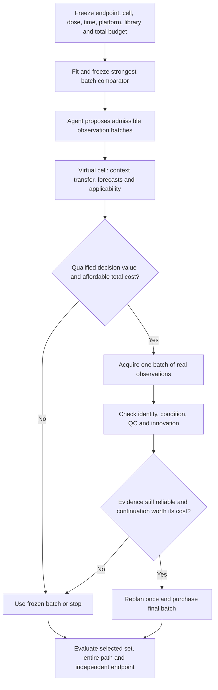

# Budgeted feedback: a testable improvement to the dual-core framework

## Scientific objective and evidence boundary

The objective is a better measured terminal decision under a common **total** resource
cap, after accounting for round trips. It is not prediction accuracy alone. The new
experiment is retrospective development: both the old 281 development compounds and
421 replay compounds have been exposed. New partitions do not restore independence.
Block P's 975 compounds are also now exposed.

Each replay episode fixes **one drug**, purchases readouts from discovery cell lines,
and selects ten sensitive backgrounds among terminal cell lines. It does not select
drugs for one fixed cell/dose/time combination. Terminal candidates in this experiment
are cell lines; active-drug coverage groups episodes by the held-out drug's activity.
Transfer to the broader biological experiment-selection task requires another
endpoint-specific evaluation.

Three older findings must remain distinct. Block N supports transcriptional transfer
over target-based prediction. Block P supports the virtual cell's contribution to
mechanism-novel discovery and secondary verification relative to the fixed workflow.
The later 421-compound replay does **not** establish adaptive selection over the strong
Gaussian batch design, including on its secondary endpoint. The first two contrasts
cannot establish the third, or independent LLM value.

## One decision contract for both cores

The agent proposes and interprets feasible actions. The world model supplies qualified
conditional forecasts. The deterministic authorization gate owns purchasing authority.
Only qualified measurements update biological evidence. KG facts, pseudo-labels and
predictions retain their distinct provenance. Existing production condition bindings
and refusal rules remain the integration points.

The diagram is the target architecture. This iteration implements a deterministic
value/stop gate and a **post hoc reliability audit**. Calibration does not yet control
purchases, and no LLM agent is evaluated. The production promotion supplies budget
arithmetic and the report check; callers must explicitly invoke the budget check
before purchasing. It does not automatically change production orchestration.

For a policy pi and realized measurements Y, define terminal utility U(pi,Y), and
resource consumption

    R(pi) = measurement_cost * n_measurements
          + turnaround_cost * n_turnarounds + declared_other_resource_cost.

Every arm must satisfy the same R(pi) <= B. A common allowance does not require each
arm to exhaust it. API, compute, QC failures and overhead need explicit costs whenever
they differ. Utility-unit costs are separately declared; resource units must never be
silently subtracted from biological utility. Existing decision_report price sensitivity
alone did not enforce this hard common cap. The new CampaignBudget contract does.

## What observations to buy, when to update and when to stop

Before deployment, estimate a *continuation advantage* over stopping, using development
episodes that emulate the entire proposed policy. For history h and batch A:

    advantage(A | h) = E[U(after A) - U(stop) | h] - utility_price(A).

Purchase only if a justified lower estimate exceeds a prespecified useful margin,
the evidence passes applicability/QC checks, and the remaining total budget permits it.
Choose batch actions before viewing any member's result. Update once per returned
batch. Preserve the stop option and all refused/failed purchases in the ledger.

The research prototype uses a deliberately small two-bin continuation rule fitted on
141 exposed development compounds, a first batch of four readouts and at most ten
additional readouts. At B=18 and round cost=2 read equivalents, one-shot batch can
afford 16 readouts; two rounds can afford 14. Seven source-only/Gaussian batch choices
compete on the same development fit set. Fixed-split, real-feedback and shuffled-feedback
controls isolate adaptation from posterior updates. These declared prices are a
sensitivity scenario, not a laboratory quote. A group bootstrap lower estimate is
not a certified per-campaign EVSI bound.

The prototype is an empirical test of this design, not a new EVSI algorithm. Joint
information, batch diversity, value of information, knowledge gradient, calibrated
help-seeking and two-stage designs all have close prior art; see the retrieved review.

## Reliability at the actual decision

Evaluate three different questions explicitly:

1. Does the interval cover the final selected top-k candidates?
2. Does it cover all selected candidates across the complete allowed decision path?
3. Does it still cover active drugs, contexts and low-support strata?

The research score is the maximum standardized residual across selected candidates
and allowed decision snapshots. Calibration uses a separate 140-compound partition and
observable first-batch innovation strata. The same old model parameters were already
tuned using that old development population, so this is an **empirical diagnostic**,
not independent conformal certification. Sparse strata must return unbounded intervals
or explicit refusal; report that frequency and interval width. Coverage made vacuous
by wide intervals is not useful reliability. No hidden activity label may choose an
action, calibration stratum or stopping rule.

The prototype's exploratory success flag checks coverage point estimates. It does not
test a coverage confidence bound, minimum active-subgroup support or useful width
threshold. Even a passing flag would not certify decision reliability.

For a new confirmation study, use untouched calibration units and a frozen policy;
replay calibration episodes with exactly the deployed selection and stopping rule.
Specify whether the intended guarantee is marginal path coverage, selected-set risk,
FCR or conditional coverage. They are different guarantees. Exchangeability, shift
weights and group support must be justified. Report uncertainty on coverage and utility,
including all abstentions and failed measurements. An active-drug subset determined
after observing truth is an audit subgroup, not a free calibration feature.

## Data scarcity: preserve cheap information without inventing outcomes

Start from the existing background-transfer and transcriptional-transfer baselines.
Reuse basal RNA, public chemical structures and frozen source-drug profiles. Add the
MAP knowledge graph as a separately ablated prior or representation. MAP's reported
transcriptomic improvements do not prove terminal viability, apoptosis or cost-aware
decision improvement. Keep drug-target text and public evidence dates/versioned edges;
exclude outcome-revealing edges and held-out drug/condition neighborhoods as required
by the registered split.

The minimum graph experiment compares: no graph; real graph; degree/type-preserving
shuffled graph; and matched-size text/target features without graph topology. Match
reference data, model capacity, compute and calibration. Require an increment over
basal similarity transfer and transcriptional nearest neighbors. Do not retune on the
confirmation population. Download small graph tables or frozen embeddings before
considering MAP's much larger training datasets.

CV offers public morphological profiles and structure/augmentation features. NLP offers
weak supervision and active selection of labels. Robotics offers simulation, domain
randomization and real-world calibration. These increase representation or development
data; none can manufacture an independent biological endpoint. Cheap image or targeted
RNA assays can replace expensive assays only after an endpoint bridge passes within
the specified cell/dose/time/platform. Distinct wells are not automatically independent
contexts, and technical replicates are not new biological cultures.

The accompanying data audit checks official sources, local exposure, matching keys and
small downloadable assets. A newly downloaded public dataset is not automatically
unexposed to pretrained models or suitable for the target endpoint.

## A genuinely informative next confirmation

Before opening new outcome measurements, freeze:

- One primary biological endpoint and useful effect margin, conditions and permitted
  terminal actions. Do not replace a failed viability endpoint with a successful RNA
  metric after observing results.
- Compound/scaffold, context, plate/culture and source exposure partitions, with a
  separate model/gate fit set, complete-policy calibration set and confirmation set.
- Total budget, round-trip scenarios, assay failures, real turnaround timestamps,
  common historical inputs and per-arm API/compute costs.
- Strongest development-selected batch; deterministic planner; ordinary LLM tool loop;
  proposed agent with the identical tools, information, model and budget; no-VC,
  real/shuffled-feedback and fixed-split controls. The current prototype makes zero
  LLM calls and cannot supply the two LLM comparisons.
- A paired cluster analysis based on independent experimental units, multiplicity
  correction and minimum useful benefit. Plan sample size from cluster-level variance
  and missingness, not from the number of individual cells or readouts. The limited
  number of independent lineages can dominate power.
- Independent outcome measurement of selected candidates and a registered random
  audit of unselected candidates. Secondary screening only among active compounds
  cannot estimate whole-library false omissions or unconditional confirmation.

The method claim would be a reliably identifiable regime where a small number of
condition-matched feedback batches changes terminal choices enough to pay for its
cost, with a useful calibrated stop option. A positive lower cluster confidence bound
above the registered useful margin must survive reliability and independent endpoint
gates. LLM advantage needs its own contrast. A new mechanism needs orthogonal functional
or perturbation evidence. Until those gates pass, promote only verified engineering
contracts and retain empirical policies in research.
