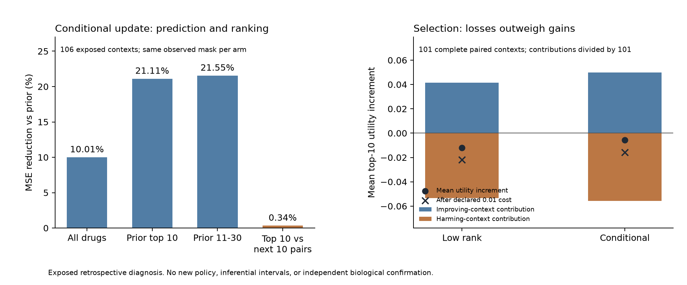

# P0: evidence qualification and archived decision-error diagnosis

Date: 2026-10-12, Asia/Shanghai. **P0 is complete; the fixed-eight-probe feedback
branch remains stopped.** The exposed archive has substantial realized selection
regret, but the tested corrections do not turn eight common probes into positive
mean drug-selection value. No new model, causal explanation or Agent advantage is
established. Source qualification identifies a possible assay-repeat study and a
small, separate secretion task, each with narrower claims than independent
biological confirmation.

This executes the [previous P0 proposal](../discrepancy_investigation_20261011/README.md).
The [execution protocol](PROTOCOL.json) defines a post hoc diagnosis, not a new
superiority test. Three agents separately audited source design, original methods,
and arithmetic/safety; the root integrated their results. All numerical outcomes
come from previously exposed [fixed8 commitments](../context_probe_20261011/README.md).
Historical packets and their receipt hashes are preserved.

## What is the immediate problem?

The missing capability is **qualified, affordable evidence that improves the
relative ranking of candidate drugs and the final functional decision**. Smaller
response-prediction error is insufficient. A proposed biological explanation also
needs an observation that can distinguish it from alternatives; residuals and
mechanism annotations cannot provide that observation by themselves.

In particular, these results do not support another fixed8 parameter search or
additional KG/LLM layers. They motivate checking which decision errors reproduce
across assay repeats, and qualifying a different evidence channel before fitting
a new acquisition/update policy. Actual useful-benefit margins and monetary cost
conversion are still unestablished.

## Archived decision-space diagnosis

All 106 intended contexts and six archived arms are retained: 636 records. The
unchanged terminal menu contains 3,613 reference-qualified drug groups, excluding
eight frozen probes. Final choices are read from immutable commitments and
checked against predictions before scoring; hidden outcomes never replace a
selected drug. Five contexts have incomplete selected endpoints in each arm, so
paired selection means use 101 contexts. Six contexts retain missing-probe
fallback and all attempted measurement charges.

The terminal utility is negative mean published exact-2.5-uM HTS log2-fold-change
over ten committed drugs. More negative response therefore means higher utility;
it does not establish clinical benefit, apoptosis, selectivity or target engagement.

| Archived arm | Mean top-10 utility increment vs prior | Improve / harm / equal, n=101 | Increment after declared 0.01 cost |
| --- | ---: | --- | ---: |
| Paid no update | 0 | 0 / 0 / 101 | -0.010000 |
| Offset | 0 | 0 / 0 / 101 | -0.010000 |
| Low rank | -0.011933 | 36 / 47 / 18 | -0.021933 |
| Shuffled low rank | -0.042848 | 37 / 54 / 10 | -0.052848 |
| Conditional residual | -0.005818 | 44 / 45 / 12 | -0.015818 |

The declared cost is ten read equivalents at 0.001 utility/read equivalent, not
an authenticated assay, turnaround or API price. [RESULTS.json](runs/archive/RESULTS.json)
also reports prices 0, 0.0001 and 0.01. No paid arm has positive mean gain even at
zero declared price. There are no new confidence intervals or significance tests.

The diagnostic fixes rank bands using **prefeedback prior predictions**. Each MSE
is first averaged over that context's measured outcomes, then over all 106
contexts. Masks are identical between arms. Pairwise MSE compares all observed
prior-top-10 versus prior-next-10 response differences within each context.

| Error measure | Prior | Conditional update | Relative reduction |
| --- | ---: | ---: | ---: |
| All terminal drugs | 0.309734 | 0.278741 | 10.01% |
| Prior ranks 1-10 | 1.598054 | 1.260656 | 21.11% |
| Prior ranks 11-30 | 1.550884 | 1.216645 | 21.55% |
| Top-10 versus next-10 pair differences | 1.329281 | 1.324807 | 0.34% |

Thus even improved absolute predictions near the boundary do not imply improved
between-drug discrimination. The offset arm supplies a concrete check: a common
shift changes absolute prediction errors while leaving ranks and pair differences
unchanged. This is a diagnostic distinction, not identification of a biological
failure cause.

For conditional updating, positive-context contributions average +0.049914 and
negative-context contributions -0.055732 over the same 101 contexts. The latter
outweigh the former. In 37 complete contexts, global MSE improves while selection
utility is harmed. Low rank replaces 133 drugs across complete contexts and
conditional updating 152; ranking changes alone are not evidence of value. The
signed added/removed-drug decomposition reproduces every paired utility change.



### Opportunity is distinct from useful purchasable information

For 75 contexts the entire fixed menu is measured. The exact retrospectively best
ten have mean utility 0.636993 above the committed zero-purchase baseline in that
population. This demonstrates remaining opportunity on the published endpoint;
it does not show which legal observation can realize it, nor establish EVSI.

For the other 31 contexts, exact full-menu oracle utility and regret are **null**.
Across the 101 complete selections, observed-subset hindsight utility gives a
mean 0.719326 **lower bound** on unknown full-menu realized regret. It is not an
upper bound, observation policy or deployable benchmark. The exact and
lower-bound means use different populations and must not be directly compared.
Retrospective noisy-outcome maximization also need not reproduce on fresh assays.

## Source qualification and corrections

The [metadata audit](data/README.md), [machine-readable qualifications](data/SOURCE_AUDIT.json),
and [original-method review](literature/DESIGN_NOTES.md) separate observed design
from unresolved stronger claims. Two official primary PRISM metadata files were
downloaded, totaling 5,322,352 bytes; source bytes, download paths and hashes are
retained. Newly considered response panels were not opened or scored.

| Source or claim | P0 result | Consequence |
| --- | --- | --- |
| PRISM repeated assay-plate design | Qualified by original methods: five-day incubation, up to three independently treated plates, one to three after QC | Lack of a literal culture_id does not invalidate assay repeats |
| Primary HTS exact-dose metadata | 11,841 replicate records; 3,947 treatment groups, each with three detection plates; 3,939 full Broad IDs | Source-library counts differ from the reference-qualified archived decision menu; primary replicate responses/raw MFI are not local |
| Secondary exact-dose metadata | 4,466 replicate records; 1,489 treatment groups, 1,488 with three plates and one with two | Existing replicate responses could support a newly declared retrospective reliability audit after endpoint/QC admission |
| Primary-secondary correspondence | 1,281 exact full-Broad-ID/dose matches; 102 drug-dose groups occur across secondary screens | These are identifier/design counts, not complete cell-drug pairs or independent validation sample size |
| Independent culture-start hierarchy | Unresolved | Assay repeats do not certify culture variance, held-out model generalization or biological-versus-technical cause |
| CXCL9 initial BxPC3 screening | Two screening files/passages, each with two technical-duplicate candidates and 24 conditions | A narrow retrospective secretion replay is conditionally qualified; 99,528 bead events are not independent biological units |
| CXCL9 secretion versus cell loss | Original paper describes a separate Caspase-3 assay; pairing is unverified | No mechanism verdict from the cached secretion files |

**Dated endpoint correction:** CXCL9 is a 24-hour **culture-supernatant secreted
protein** measured with a LEGENDplex capture-bead sandwich assay and FACS PE. It
is not intracellular CXCL9 or a single-cell protein measurement. The old card is
preserved; [the dated correction](literature/DESIGN_NOTES.md#dated-cxcl9-correction)
supersedes those terms. The cached raw context is BxPC3, with 1 ng/mL cytokine and
5 uM inhibitor; the separate AsPC1 source uses 10 ng/mL cytokine. Context and dose
are therefore confounded in that comparison.

The publisher Fig. 5 archive attempt returned a reCAPTCHA HTML page, not a ZIP;
the mirror failed TLS, and BioStudies routes did not expose pairing metadata.
These receipted access failures leave orthogonal-channel pairing unresolved.
They do not prove that matched data do not exist. No archive members/outcomes
were read. Original BATCHIE methods and Zenodo metadata were also checked; its
pair/triplet response files were not downloaded. PRISM, CXCL9 and BATCHIE are
prior work to account for, not evidence of this framework's novelty.

## Action/observable matrix and next commitment

| Candidate evidence action | What it can observe | What it does not identify | Current admission |
| --- | --- | --- | --- |
| Repeat matched PRISM treatment on an assay plate | Stability of measured drug-response differences and selected-set utility | Whether a stable residual arises from compensation, stress, drug-specific batch effects or target engagement | Repeat design qualified; primary outcomes absent, secondary QC/pairing not yet admitted |
| Buy existing L1000 RNA signature | Transcriptional response at its declared dose/time/platform | The matched five-day 2.5-uM viability endpoint without a separately supported bridge | Not qualified for same-condition mechanism adjudication |
| Reveal one CXCL9 condition summary in a declared screening | Secretion response to a cytokine/inhibitor condition | Per-live-cell secretion, apoptosis or independent context transport | Conditionally qualified for a separate BxPC3 secretion replay |
| Measure paired Cas3 and live-cell counts under matched treatment | Evidence about apoptosis/cell number alongside secretion | Every pathway cause; matched intervention/rescue is still needed for stronger attribution | Pairing/readout contract unresolved |
| Read a KG edge or MoA annotation | A source-supported candidate hypothesis | A measured discriminating response | Hypothesis prior only |

The first next commitment is a **repeat-stability qualification**, not another
feedback optimization: freeze the metadata-defined drug/cell/dose/screen panel,
QC handling, treatment-to-detection mapping and all intended cases before opening
replicate responses. Preserve plate/pool dependence and published shared
normalization. Determine whether the decision-relevant response differences and
errors reproduce; declare incomplete pairs rather than selecting favorable cases.
This would remain retrospective reliability evidence, not an independent
scientific confirmation or a new claim that the existing eight probes work.

Only reproducible decision errors and a qualified distinct evidence channel can
justify a new functional policy study. Such a study needs a new protocol with
pre-action recruitment, a fixed purchase/terminal menu, measurement failures,
justified MUB, sample-size rationale and real cost/turnaround basis. Controls must
include the strongest batch/zero-purchase prior, paid no update and shuffled
evidence. Agent attribution additionally needs the same-information deterministic
planner and ordinary LLM tool loop. No Agent/KG/model extension is released from
this P0 packet; mechanism attribution remains non-identifiable with the currently
audited action menu.

## Reproduction and verification

The existing `maestro` environment supplies NumPy, pandas, pytest and Matplotlib.
Archive diagnosis took 0.84 seconds in this run, with zero new fits, LLM calls or
wet measurements. It reads retained predictions instead of rerunning models.
Input NPZ/source assets under ignored data paths remain necessary; a clean
checkout must recover their exact recorded hashes, not substitute another panel.

From `D:/MAESTRO`:

```powershell
# Use verified cached metadata; reruns preserve original download receipts.
& D:/anaconda/envs/maestro/python.exe research/discrepancy_p0_20261012/audit_sources.py
& D:/anaconda/envs/maestro/python.exe -m pytest research/discrepancy_p0_20261012/tests/test_safety.py -q
# A fresh output directory is mandatory; retained archive receipts are not overwritten.
& D:/anaconda/envs/maestro/python.exe research/discrepancy_p0_20261012/diagnose_archive.py --output research/discrepancy_p0_20261012/runs/reproduction
& D:/anaconda/envs/maestro/python.exe research/discrepancy_p0_20261012/review/verify.py --output research/discrepancy_p0_20261012/runs/archive
& D:/anaconda/envs/maestro/python.exe research/discrepancy_p0_20261012/plot_diagnosis.py
```

The independent [verification receipt](review/VERIFICATION.json) reconstructs all
636 records and summaries without importing producer scoring/model helpers,
checks source/design tables and original/new hash chains. Eleven safety tests
pass, including hidden-outcome invariance, missing-selected-endpoint retention,
exhaustive toy-oracle arithmetic and axis/identity rejection. Thirteen metadata
checks also pass. These are arithmetic/design and software checks, not biological
validation. [EXECUTION_RECEIPT.json](EXECUTION_RECEIPT.json) pins the final packet
and documentation checks. All experimental code remains in this research folder;
no `src` or `tools` module is promoted.
