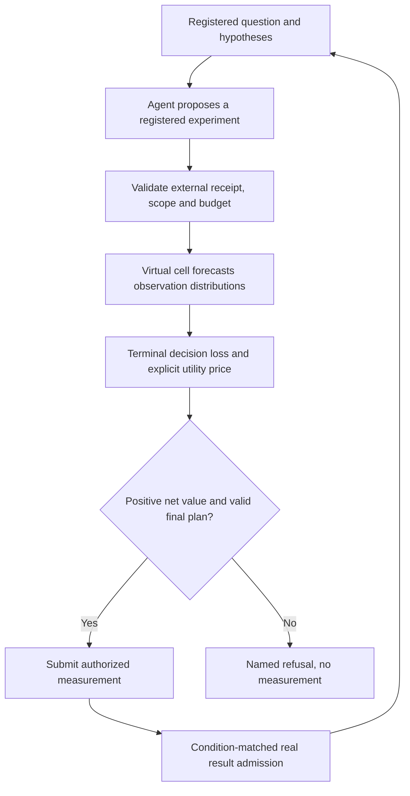

# Condition-bound decisions for the two MAESTRO cores

The deployed improvement is an explicit, opt-in interface between scientific proposals, forecast distributions and measurement authorization. It reuses the existing decision-value calculation, prediction cache, result admission and budget ledger. Experimental biological models remain in this study until their comparison gates pass.



## Production changes

| Location | Changed behavior | Evidence boundary |
|---|---|---|
| `src/maestro/decision_value_policy.py` | Immutable, SHA256-pinned evaluation receipt; separate utility prices and experimental budget; exact question, hypothesis, full interpretation rules/settings, source, model and action-condition binding | File identity and matching do not prove that the receipt's calibration or transport claims are true |
| `src/agent/orchestrator.py` | Optional `selection_strategy="decision_value"`; terminal-value selection; preflight before forecasting; final action and hypothesis recheck; refusal cannot fall back to coverage | Uses the existing myopic hypothesis-decision loss, not every biological terminal objective |
| `src/maestro/acquisition.py` | Forecast provenance survives into the new decision contract | A forecast retains prediction status and cannot create measured evidence |
| `src/virtual_cell/routing.py` | Reference preferences scoped to model, context, dataset, readout, intervention mode, dose and time | Support and compute cost are externally declared inputs; they do not certify model quality |
| `src/virtual_cell/world_model.py` | Multiple eligible backends require a frozen scoped policy; otherwise ambiguity is refused. Reference support, then compute cost, then backend name determine the route | Backend registration order no longer chooses a scientific prediction |
| `src/virtual_cell/interface.py` | A composite assessment must name an exact declared catalog member with the requested model version | Foreign assessment identities remain refused |
| `tools/evaluation/decision_report.py` | Matched campaign utility, explicit measurement and turnaround prices, whole-cluster bootstrap and sign-flip statistics | Scenario prices are not measured laboratory costs; repeated campaign rows do not create independent biological units |

The three existing runtime selection modes keep their defaults. The new mode requires qualifying external evidence and cannot be enabled by an LLM reply. Receipt examples and the numerical prototype are in [interface/README.md](interface/README.md). The route also enters prediction-cache identity: changing the routing evidence or preference values changes the backend identity, while reordering an equivalent registry does not. Routing refusal incurs zero inference cost.

## Why this is the chosen scope

Adding a large latent-state or multimodal model before a measured bridge passes would repeat the repository's cross-platform and wrong-time failures. Adding a critic without an incremental comparison would repeat Blocks M/N/P. Instead, the formal runtime keeps the measured-evidence boundary and exposes what must be supplied before a forecast can purchase an experiment.

The existing value calculation is a Bayes calculation over a registered observation likelihood. It assigns zero value to an observation that cannot change the terminal decision and subtracts an explicitly supplied utility price. Its positive output is model-conditional expected value, not a calibrated lower confidence bound on future biological gain. External evaluation must test the distribution, selection process and endpoint transport before providing an admitted receipt.

The biological experiment separately evaluates a reference-profile particle model and terminal knowledge-gradient design. These established methods are research candidates, not new foundation models or promoted causal mechanisms. Their performance, uncertainty, cost and attribution controls determine promotion. See [literature/NOVELTY.md](literature/NOVELTY.md) for the closest prior work and the claims that remain unestablished.

## Reproduction

Use the user's `maestro` conda environment. On this workspace its interpreter is `D:/anaconda/envs/maestro/python.exe`.

```powershell
& 'D:/anaconda/envs/maestro/python.exe' -m pytest tests/test_backend_routing.py tests/test_terminal_value_policy.py tests/test_decision_report.py
& 'D:/anaconda/envs/maestro/python.exe' research/dual_core_scientific_20261011/routing/verify_prototype.py
& 'D:/anaconda/envs/maestro/python.exe' -m research.dual_core_scientific_20261011.report.verify_prototype
& 'D:/anaconda/envs/maestro/python.exe' -m tools.evaluation.decision_report --help
```

The paired report CLI requires a JSON list of `CampaignResult` records, two arm names, and both utility prices. It rejects incomplete pairs, duplicates, changed problem identity, changed budget and overspending. Its problem SHA256 should bind the endpoint, candidate library, population and experimental conditions. Monte Carlo sign-flip probabilities use a plus-one correction and state their simulation resolution.

API audit scenarios and analytic prototypes are engineering evidence. The PRISM replay uses real recorded observations but previously exposed data, and has its own frozen protocol. The newly downloaded CXCL9 data are a source audit and future endpoint candidate; they have not validated a promoted multimodal model.
