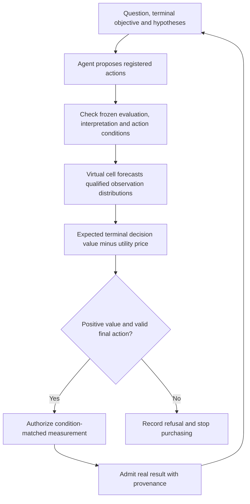

# Scientific decision interface for MAESTRO's two cores

As of 2026-10-11, this work delivers an opt-in, condition-bound decision interface in `src`, a paired cost-aware evaluator in `tools`, and a frozen real-observation replay in `research`. **The engineering improvements are verified; the proposed adaptive policy does not establish an advantage over a strong batch design.** Its biological predictor and acquisition policy therefore remain experimental. No independent LLM gain, new causal mechanism, or general cross-assay transport is claimed.

The work used three agents for architecture, experiment and literature tasks, followed by a separate contract review and arithmetic reconstruction. It builds on the existing MAESTRO compiler, acquisition calculation, evidence admission, cache and budget ledger. It does not replace them with another parallel framework.

## What changes in the framework

The agent proposes registered hypotheses and feasible experiments. The virtual cell supplies model-identified observation distributions. A deterministic decision gate checks the frozen evaluation contract, computes terminal decision value, and authorizes a measurement only when its net value is positive and the final action still matches the contract. Qualified measured results, with their actual conditions, then update the case.



| Formal component | Improvement | Verification |
|---|---|---|
| `maestro.decision_value_policy` | Immutable SHA256-pinned external receipt binds hypothesis definitions, full interpretation rules and table settings, terminal endpoint, utility prices, model/source revisions and complete action conditions | Changed hypotheses, rules, classifier settings, scope or forecasts refuse; receipt mutation and changed source bytes cannot silently reuse the old contract |
| `agent.orchestrator` | Optional `selection_strategy="decision_value"`; checks before forecasting, then rechecks the final repaired action and hypotheses | An LLM cannot buy a flat-value action or restore a refused purchase through repair or a coverage fallback |
| `virtual_cell.routing` and composite world model | Frozen preferences for the exact context, dataset, dose, time, intervention mode and readouts; reference support precedes declared compute cost | Backend registration order cannot change a qualified route; ambiguous or out-of-scope routes refuse |
| `virtual_cell.interface` | Selected assessment must identify an exact member of the composite's declared backend catalog | A valid alternate catalog member is accepted; foreign identities remain refused |
| `tools.evaluation.decision_report` | Strictly paired terminal utility, measurement and turnaround accounting, whole-mechanism-cluster bootstrap and sign-flip statistics | Missing pairs, duplicate campaigns, altered problem identity and overspending reject; sampled tests cannot report p=0 |

The new decision strategy is opt-in. Production uses the existing **myopic hypothesis-decision loss**; it is not the top-10 PRISM utility used by the research particle policy. A production receipt requires a separately qualifying evaluation of its own observation distribution, objective and selected population. The failed replay is not converted into an admitted production receipt. A hash authenticates bytes and semantics; it cannot establish that an external calibration or support declaration is scientifically correct.

The receipt also separates two quantities that were easy to conflate: `EvidenceAction.cost` consumes the hard experimental budget, while the declared measurement price is in terminal-loss units. Backend compute cost is a routing declaration. None is automatically an authenticated laboratory invoice. Forecasts retain prediction status and cannot create measured evidence or a biological verdict.

See [IMPLEMENTATION.md](IMPLEMENTATION.md) and [interface/README.md](interface/README.md) for the implementation and receipt contract. The routing and reporting prototypes were first implemented here and are byte-identical to the promoted modules. The interface prototype and behavioral contracts exercise the production implementation.

## Frozen experiment and results

The experiment tests whether feedback-directed observation selection improves a terminal biological decision at the same measurement budget. Only 701 reference compounds determine preprocessing, nuisance axes and eligible panels; 281 calibration compounds choose parameters and the strongest batch baseline. All 421 input-qualified algorithm-test compounds are included, without selecting the primary cohort by hidden killing outcomes.

For each query, the policy sees existing L1000 inputs and may purchase up to 16 recorded PRISM measurements from a 64-line discovery menu. It finally chooses 10 lines in a disjoint terminal menu whose measurements cannot be purchased. Utility is the negative mean recorded selective residual on those selections. This is a measured viability-derived decision endpoint, not a mechanism-causality test. Both the model and policy were frozen before these new algorithm-test metrics were examined.

The 421 compounds were used in old Block N. They are **previously exposed public biological data**, despite separation from the present algorithm's calibration. This is retrospective replay, not an untouched biological holdout. The empirical reference-profile particle model is a research surrogate, not new inference from the pretrained STATE checkpoint. The biological experiment makes **zero LLM/API calls** and does not attribute deterministic acquisition performance to a language agent.

| Registered contrast at 16 reads | Paired utility increment | Nominal 95% drug-bootstrap interval | Holm one-sided p | Result |
|---|---:|---|---:|---|
| Adaptive minus strongest calibration-selected batch Gaussian design | +0.00217 | [-0.01562, +0.01970] | 0.40643 | Not supported |
| Adaptive minus no-L1000 policy | +0.03156 | [+0.00975, +0.05388] | 0.00690 | Pass in this replay |
| Adaptive minus feedback-shuffled policy | +0.07335 | [+0.04900, +0.09957] | 0.00015 | Pass in this replay |

The registered dual-core gate is **NOT_CONFIRMED**. It requires all three primary contrasts to pass, terminal precision to decline by no more than 0.02 versus the strongest batch arm, and a positive lower interval bound for secondary-screen adaptation. The primary Gaussian comparison changes both posterior and acquisition design. A supplement, frozen before reading test results, isolates acquisition with the **same particle posterior** in both arms: adaptive utility exceeds batch by +0.00840, interval [-0.00412, +0.02094], one-sided secondary p=0.09615. Adaptive minus a fixed reference-variance library is +0.00910, interval [-0.00299, +0.02167]. Neither comparison confirms the utility gain. These secondary analyses do not replace the original gate.

The information and feedback controls support the usefulness of their contents within this policy and endpoint. They do not show that adaptation is necessary or that the agent improves on a conventional tool loop. Mechanism-string clustering gives 211 clusters; its sensitivity intervals preserve the same main conclusions. Mechanism annotations do not certify independent cultures, and the reported drug intervals are nominal rather than simultaneous family-wise intervals.

**Reliability fails where it matters most.** The frozen 90% simultaneous prediction interval covers 90.74% of test compounds overall, but only 62.38% of the 101 descriptively identified active compounds; full interval width is about 5.45 utility coordinates. Marginal coverage cannot authorize high-activity selection. On independently measured PRISM secondary data, the paired adaptive-versus-Gaussian utility increment is -0.05468 [-0.12487, +0.01111], n=116; selective-profile correlation declines by -0.04282 [-0.06787, -0.02073]. Secondary availability is incomplete and selection-dependent, and its dose selection differs. It does not confirm transport or fresh biological replication.

Detailed methods, all ten arms, budgets 2/4/8/16, eligibility rules and limitations are in [experiment/README.md](experiment/README.md). Frozen numbers are in [TEST_RESULTS.json](experiment/TEST_RESULTS.json), [SUPPLEMENT_RESULTS.json](experiment/SUPPLEMENT_RESULTS.json) and [COST_SCENARIOS.json](experiment/COST_SCENARIOS.json).

## Efficiency and independent checks

Both adaptive and batch policies buy 16 readouts, but use 16 and 1 simulated turnarounds respectively. A declared price of 0.001 utility units per turnaround makes adaptive-minus-Gaussian net utility **-0.01283**, and adaptive-minus-same-posterior batch **-0.00660**. At 0.01 those increments become -0.14783 and -0.14160. These are explicit sensitivity scenarios, not measured wet-lab prices. Shared cached feature work prevents treating per-arm CPU times as independent cold-start benchmarks.


Calibration took 178.0 seconds, the primary 421-by-9-arm replay 579.3 seconds, and the same-posterior supplement 285.6 seconds in the `maestro` environment with one BLAS thread. Existing prediction caching is preserved and routing-policy identity enters the cache key. Refusing before outcome forecasting avoids unnecessary outcome-model calls; unresolved backend routing records zero inference cost.

All 3,789 primary and 702 supplementary terminal ledgers were independently reconstructed, with maximum metric error 2.22e-16. There are no duplicate, terminal-menu or over-budget purchases. Poisoning terminal truth leaves actions and predictions unchanged; changing a purchased first observation changes the second action in 7/8 development cases. A separate rerun on eight algorithm-test compounds reconstructs all ten policies and all four budgets: 320 rows, maximum metric error 8.88e-16. These checks verify information access and arithmetic, not biological independence. The null outcome-association shuffle diagnostic is retained in [VERIFIED.json](experiment/VERIFIED.json).

The ledger archives are lossless and total 18.87 MB; their expanded 94.34 MB remains locally ignored. Production reporting contracts export 4,210 matched campaign records. The four derived input NPZ files total 87.43 MB under ignored external data and are absent from a clean checkout. [SOURCE_REACQUISITION.json](experiment/SOURCE_REACQUISITION.json) records public upstream versions, URLs and hashes, but automated raw-to-derived restoration was not implemented. Missing assets must cause an explicit refusal rather than synthetic results.

## API, papers and new data

The separate [API audit](api_audit/README.md) used the configured DeepSeek provider for four real HTTP requests and 4,896 reported tokens. Synthetic scenarios show that deterministic authorization can override a flat-value agent proposal and refuse uninformative or shifted forecasts. Historical response records are preserved; six offline response replays include the final interpretation-bound schema. No real measurement was purchased and no biological endpoint was established. Monetary API cost is unavailable; no credential is stored in the packet.

The [targeted review](literature/REVIEW.md) verifies **16 references**, with exact source identities, claim boundaries and retained retrieval failures. BATCHIE, DrugReflector and the 2026 CXCL9 mechanistic-active-learning study are close prior art. EVSI and correlated knowledge gradient already provide decision-theoretic acquisition. Feedback-covariate-shift conformal work explains why selected candidates need more than marginal calibration. BioDiscoveryAgent, LLM-feedback permutation studies, State, LPM and strong perturbation benchmarks constrain the proposed agent and model claims. The verified final State DOI is [10.1016/j.cell.2026.07.052](https://doi.org/10.1016/j.cell.2026.07.052).

This work's current contribution is a verified scientific decision contract and a controlled evaluation of its candidate policy. A worldwide novelty or superior scientific method claim is not established. [NOVELTY.md](literature/NOVELTY.md) maps each proposal to its closest prior work and identifies what additional evidence would support a stronger contribution.

A new **5.36 MB CXCL9 packet** was downloaded from the official source at a pinned commit: two backgrounds with 24 measured conditions each, plus BxPC3 raw FACS and network/model inputs. The six MIDAS time coordinates are a model grid, not six measured times; several protein columns contain constraints/placeholders. Single-cell events are nested observations, not independent cultures. Full-outcome normalization may also leak a sequential replay's hidden values. The [dataset audit](literature/DATASET.md) records these exclusions. Downloading it does not constitute a new positive experiment.

## Delivery and reproduction

Promoted: the frozen decision-value contract, opt-in orchestration path, scoped backend routing and paired utility/cost evaluator. Retained in `research`: the particle predictor, adaptive policy, freezes, replay records, literature and dataset audit. The existing P0.6/P2 source and scientific gates are unchanged. The separately retained feasibility files at `research/astra/adaptive_investigation_20261011/` are exploratory only: they have no registered freeze, sealed confirmation or independent verification and contribute no promotion evidence.

Use `D:/anaconda/envs/maestro/python.exe` from the repository root:

```powershell
& 'D:/anaconda/envs/maestro/python.exe' -m pytest
& 'D:/anaconda/envs/maestro/python.exe' research/dual_core_scientific_20261011/interface/prototype.py
& 'D:/anaconda/envs/maestro/python.exe' research/dual_core_scientific_20261011/routing/verify_prototype.py
& 'D:/anaconda/envs/maestro/python.exe' -m research.dual_core_scientific_20261011.report.verify_prototype
& 'D:/anaconda/envs/maestro/python.exe' research/dual_core_scientific_20261011/api_audit/verify_provider_smoke.py
& 'D:/anaconda/envs/maestro/python.exe' research/dual_core_scientific_20261011/experiment/replay_check.py
```

The final default suite has **772 passes and one existing repository-shape failure**: tracked root `Innovation.md` conflicts with a test that requires its absence. The file was not deleted and the test was not relaxed. Exact delivered hashes, prototype parity and test evidence are in [ENGINEERING_RECEIPT.json](ENGINEERING_RECEIPT.json); these are engineering evidence only. Archive restoration and full scientific replay prerequisites are documented separately in the experiment README.

A qualifying next study needs a distinct measured population, a fixed biological objective and terminal menu, a useful predeclared net-benefit threshold, same-posterior batch and strong Gaussian controls, selection-relevant calibration, and actual turnaround costs. Any LLM claim additionally needs a same-tool, same-information agent ablation against the deterministic planner and ordinary LLM-plus-tool loop. A mechanism claim needs independent measured mechanism evidence. Increasing architecture size before these comparisons pass would not resolve the observed failure.
