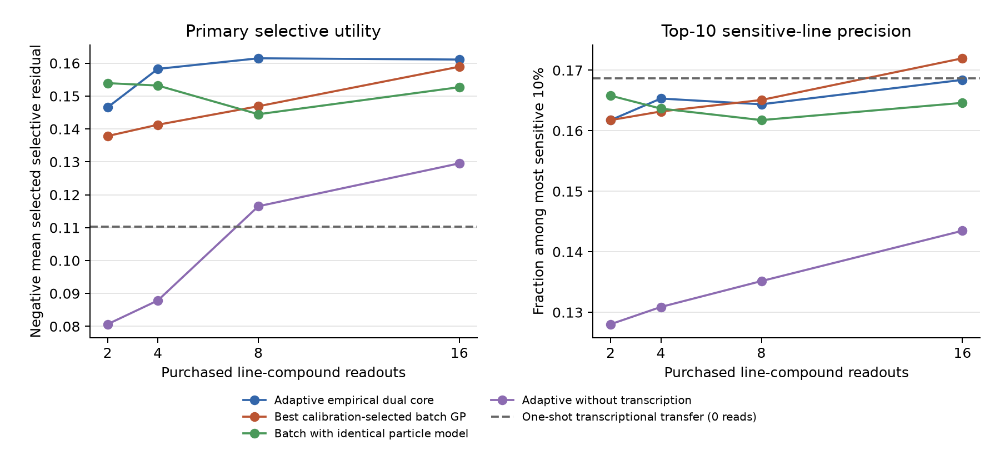

# Frozen scientific-decision campaign replay

The registered dual-core verdict is **NOT_CONFIRMED** on 421 retrospective drug campaigns. The observation-dependent deterministic policy is compared with the strongest calibration-selected batch model and with a separately frozen batch policy that uses the identical particle posterior. The latter utility difference is +0.0084 [-0.0041, +0.0209]. These are empirical-library policies; **zero LLM/API calls** were made.

## What is measured

Every campaign receives a query compound's existing L1000 inputs, and may buy up to 16 recorded PRISM primary measurements from a 64-line reference-derived discovery menu. It then selects 10 unpurchasable terminal lines. The primary utility is the negative mean observed selective residual of those selections, after removing offset and the fixed reference-derived generic-sensitivity axis. Precision describes overlap with the most sensitive 10% of recorded terminal lines. Neither metric establishes a causal mechanism or prospective experimental discovery.

Only 701 old Block N reference compounds fit source moments, nuisance coefficients and candidate panels. The 281 development compounds select temperature, observation noise and the best fixed baseline. The 421 old confirmation compounds evaluate the frozen algorithm. **All these public compounds were already exposed in earlier studies**: this is algorithm separation within retrospective data, not a newly untouched biological holdout. Every input-qualified test compound is included; hidden killing activity never filters the primary population. The source pool excludes the query's exact annotated mechanism class. Cell-line identities are known from references, so this is not unseen-cell-context generalization.

`PROTOCOL_FREEZE.json` binds protocol and source bytes before new campaign metrics; `CALIBRATION_FREEZE.json` binds executable code, chosen parameters and calibration rows before the algorithm-test replay. A clarification about calibrating the particle temperature rather than the parameter-free kNN comparator is recorded in `DEVIATIONS.json`.

## Registered results at 16 reads

| Contrast | Comparison | Mean paired utility difference [95% drug bootstrap] | Holm p | Verdict |
|---|---|---:|---:|---|
| adaptation | adaptive_dual minus batch_gp_ivr | +0.0022 [-0.0156, +0.0197] | 0.40643 | NOT_SUPPORTED |
| transcription | adaptive_dual minus adaptive_without_l1000 | +0.0316 [+0.0098, +0.0539] | 0.00690 | PASS |
| feedback | adaptive_dual minus adaptive_feedback_shuffle | +0.0733 [+0.0490, +0.0996] | 0.00015 | PASS |

The primary comparison against a Gaussian posterior changes both acquisition and posterior model. It evaluates the complete proposed policy against a strong practical alternative, and cannot alone attribute a difference to adaptation. `fixed_library` preserves the particle model but uses a reference-variance panel; its separate contrasts are retained in `SUPPLEMENT_RESULTS.json`.

| Arm | Primary utility | Precision | Selective r | Secondary utility | Reads/campaign | Turnarounds/campaign |
|---|---:|---:|---:|---:|---:|---:|
| adaptive_dual | 0.1611 | 0.1684 | 0.1335 | 0.1790 | 16 | 16 |
| adaptive_feedback_shuffle | 0.0878 | 0.1416 | 0.0976 | 0.0094 | 16 | 16 |
| adaptive_signature_shuffle | 0.0883 | 0.1394 | 0.0802 | -0.0309 | 16 | 16 |
| adaptive_without_l1000 | 0.1295 | 0.1435 | 0.1151 | 0.0141 | 16 | 16 |
| batch_gp_ivr | 0.1589 | 0.1720 | 0.1265 | 0.2244 | 16 | 1 |
| batch_gp_kg | 0.1581 | 0.1701 | 0.1251 | 0.2213 | 16 | 1 |
| batch_particle_kg | 0.1527 | 0.1646 | 0.1307 | 0.1518 | 16 | 1 |
| fixed_library | 0.1520 | 0.1632 | 0.1296 | 0.2068 | 16 | 1 |
| random_library | 0.1445 | 0.1653 | 0.1244 | 0.1657 | 16 | 1 |
| source_only | 0.1103 | 0.1686 | 0.0666 | 0.2544 | 0 | 0 |

The one-shot arm buys zero new measurements. All L1000 acquisition cost is shared input and has not been authenticated as a procurement price. Adaptive turnarounds are simulated sequential decision rounds; no wet-lab experiment was purchased. Feature similarities are cached and shared, so per-arm CPU times are not independent cold-start cost estimates. Calibration took 178.0 seconds and the full primary replay took 579.3 seconds in the maestro Python environment.



## Identical-posterior acquisition control

While the primary replay was running and before any algorithm-test values or summaries were inspected, an independent review identified the Gaussian-versus-particle confound. `SUPPLEMENT_PROTOCOL.json` and `SUPPLEMENT_FREEZE.json` freeze a secondary comparator; the original primary protocol and executable hashes remain unchanged. The batch comparator precomputes its entire plan from the exact initial particle Gaussian moments, with covariance-only updates and zero innovation. Both policies subsequently condition the **same particle posterior on purchased true values**. Its first action and EVSI match the adaptive policy on 8 development cases.

| Metric, adaptive minus identical-posterior batch | Mean paired difference [95% drug bootstrap] | Uncorrected secondary p |
|---|---:|---:|
| utility | +0.0084 [-0.0041, +0.0209] | 0.09615 |
| precision | +0.0038 [-0.0036, +0.0114] | 0.17644 |
| selective_r | +0.0028 [-0.0004, +0.0061] | 0.04765 |
| secondary_utility | +0.0219 [-0.0272, +0.0711] | 0.19319 |
| secondary_precision | +0.0049 [-0.0124, +0.0224] | 0.29464 |
| secondary_r | +0.0045 [-0.0044, +0.0135] | 0.16259 |

The identical-posterior batch primary utility is 0.1527, against 0.1611 for adaptation. Secondary-screen contrasts use independently measured values that never enter policy updates; paired availability and uncertainty are recorded in JSON. These secondary contrasts do not replace the registered primary gate or constitute fresh biological replication. Secondary availability is incomplete and dose selection differs from the primary screen. Requiring at least five selected lines with secondary values makes eligibility selection-dependent; paired comparisons use the intersection and do not correct this missingness bias. Drug sign-flip p-values assume symmetric paired differences under the null, and are not a randomized prospective laboratory trial.

## Reliability and efficiency

A finite-sample 90% conformal order statistic on development campaigns bounds the maximum absolute selective-coordinate prediction error across all terminal lines. The frozen bound is evaluated without test adjustment. This is marginal coverage under exchangeability, and wide intervals do not establish useful biological precision.

| Arm | Test simultaneous coverage | Active-drug subgroup coverage | Full interval width |
|---|---:|---:|---:|
| adaptive_dual | 0.907 | 0.624 | 5.450 |
| adaptive_feedback_shuffle | 0.914 | 0.653 | 5.596 |
| adaptive_signature_shuffle | 0.907 | 0.624 | 5.614 |
| adaptive_without_l1000 | 0.907 | 0.624 | 5.583 |
| batch_gp_ivr | 0.917 | 0.663 | 5.527 |
| batch_gp_kg | 0.914 | 0.653 | 5.470 |
| fixed_library | 0.907 | 0.624 | 5.604 |
| random_library | 0.910 | 0.634 | 5.585 |
| source_only | 0.900 | 0.604 | 5.567 |

The active-drug subgroup is descriptive, defined only during evaluation; it is not a selected primary cohort. Mechanism-cluster bootstrap intervals and the production `paired_campaign_report` independently assess dependence sensitivity. Prices below are **declared utility-unit scenarios, not real laboratory or monetary costs**. Measurements are equal between these comparisons; a sequential adaptive policy uses 15 additional turnarounds.

| Comparator | Price per turnaround | Net adaptive utility difference | Mechanism-cluster 95% interval |
|---|---:|---:|---|
| batch_gp_ivr | 0.000 | +0.0022 | [-0.0176, +0.0197] |
| batch_gp_ivr | 0.001 | -0.0128 | [-0.0326, +0.0047] |
| batch_gp_ivr | 0.010 | -0.1478 | [-0.1676, -0.1303] |
| batch_particle_kg | 0.000 | +0.0084 | [-0.0035, +0.0202] |
| batch_particle_kg | 0.001 | -0.0066 | [-0.0185, +0.0052] |
| batch_particle_kg | 0.010 | -0.1416 | [-0.1535, -0.1298] |

## Verification and artifacts

Source/execution digests match. Independently recomputing all 3789 primary terminal ledgers gives maximum metric error 2.22e-16; 702 supplementary ledgers also agree. There are no duplicate, terminal-line or over-budget purchases. Poisoning terminal truth leaves full action traces and predictions unchanged in eight development cases; changing the first bought value changes the second action in 7/8 cases. Feedback and signature permutations are retained as controls. `VERIFIED.json` also preserves the outcome-association shuffle diagnostic; no control is silently removed.

`TEST_ROWS.csv` retains all 2/4/8/16 cost rows; `TEST_LEDGER.jsonl.gz` and `SUPPLEMENT_LEDGER.jsonl.gz` are lossless archives of predictions, selected identities, purchases and evaluation truth. `CAMPAIGN_RESULTS.json` exports the production reporting contract, and `COST_SCENARIOS.json` records independent cluster statistics and explicit prices. Original expanded ledgers remain local and are ignored by this study directory's `.gitignore`.

## Reproduction

Use `D:/anaconda/envs/maestro/python.exe` or an equivalent environment with NumPy, SciPy, pandas, matplotlib and threadpoolctl. From repository root, the original execution order in a fresh output directory was:

```powershell
& 'D:/anaconda/envs/maestro/python.exe' research/dual_core_scientific_20261011/experiment/run.py calibrate
& 'D:/anaconda/envs/maestro/python.exe' research/dual_core_scientific_20261011/experiment/run.py evaluate
& 'D:/anaconda/envs/maestro/python.exe' research/dual_core_scientific_20261011/experiment/supplement.py
& 'D:/anaconda/envs/maestro/python.exe' research/dual_core_scientific_20261011/experiment/run.py analyze
& 'D:/anaconda/envs/maestro/python.exe' research/dual_core_scientific_20261011/experiment/verify.py
& 'D:/anaconda/envs/maestro/python.exe' research/dual_core_scientific_20261011/experiment/analyze_supplement.py
& 'D:/anaconda/envs/maestro/python.exe' research/dual_core_scientific_20261011/experiment/export_decision_report.py
& 'D:/anaconda/envs/maestro/python.exe' research/dual_core_scientific_20261011/experiment/report.py
```

Calibration/evaluation refuse to overwrite completed freezes or outputs. To verify retained archives, first run `archive_ledgers.py --restore`, then `run.py analyze`, `verify.py` and `analyze_supplement.py`; all source assets are still needed for the poisoning/source checks. `replay_check.py` independently reruns all ten frozen policies and all four budgets on eight algorithm-test compounds, compares every retained primary and secondary metric, and writes a separate receipt without changing the original outputs. `replay_check.py --all` extends that algorithm reconstruction to the complete test population. The sample reconstruction is software verification on test data, not additional calibration.

The four frozen derived npz inputs under ignored `data/external` occupy about 86 MB. A clean checkout **does not contain these assets** and correctly refuses missing or digest-mismatched inputs. `SOURCE_REACQUISITION.json` contains verified public PRISM figshare v4 download URLs, sizes and md5 values (137,848,721 bytes across four raw CSV files), plus the GEO L1000 source URL. Old Block M/N extraction scripts and receipts specify the transformation and SHA hashes; their write-once behavior means recovering missing derived assets requires a separate staged rebuild. Automated raw-to-derived restoration was not implemented or claimed here. No new dataset was downloaded for the experiment, and existing unrelated research files were not edited.

No empirical prediction or adaptive-planning algorithm is promoted to production by this replay. The useful engineering contracts are truthful observation access, deterministic provenance, typed paired campaigns and explicit cost accounting; predictive or Agent superiority needs an additional qualifying experiment.
